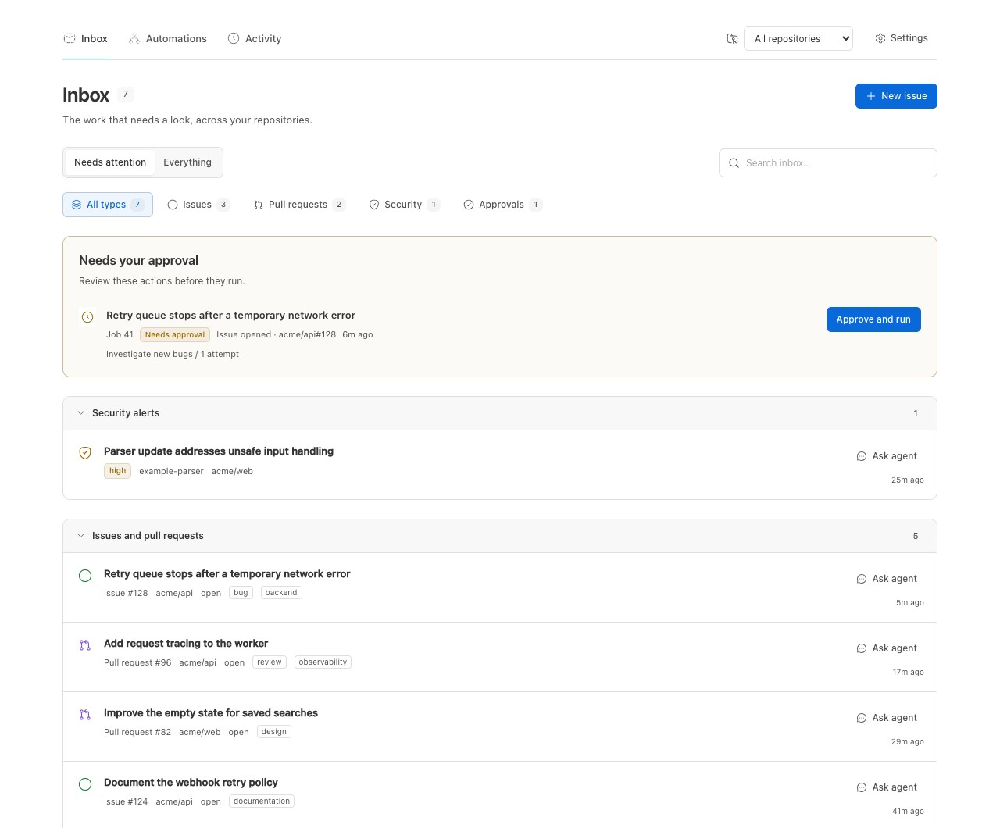
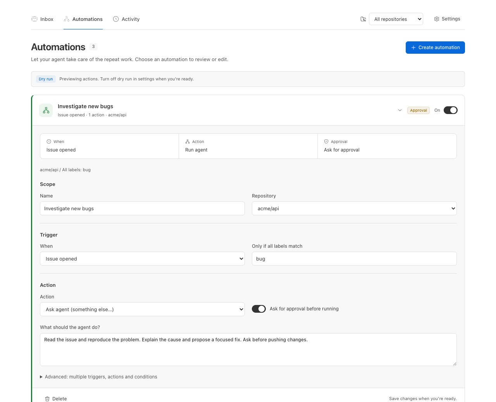
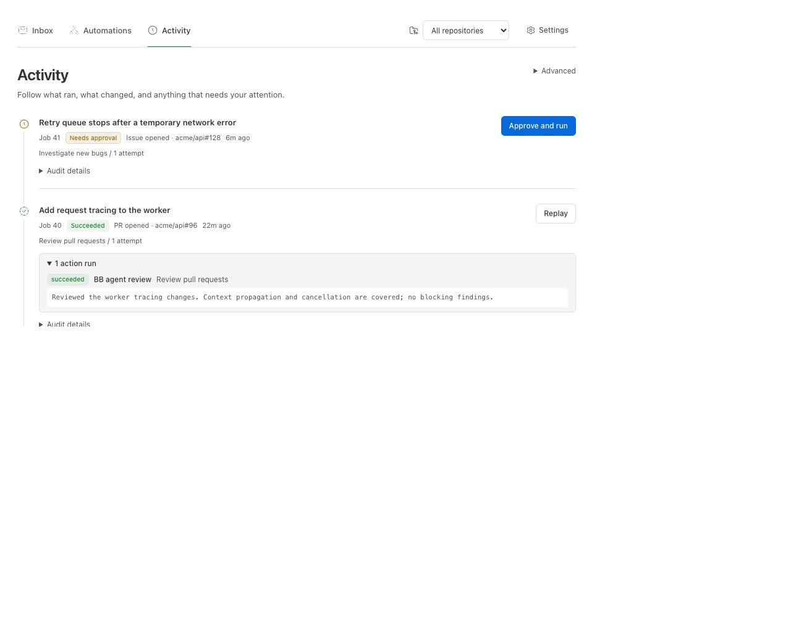
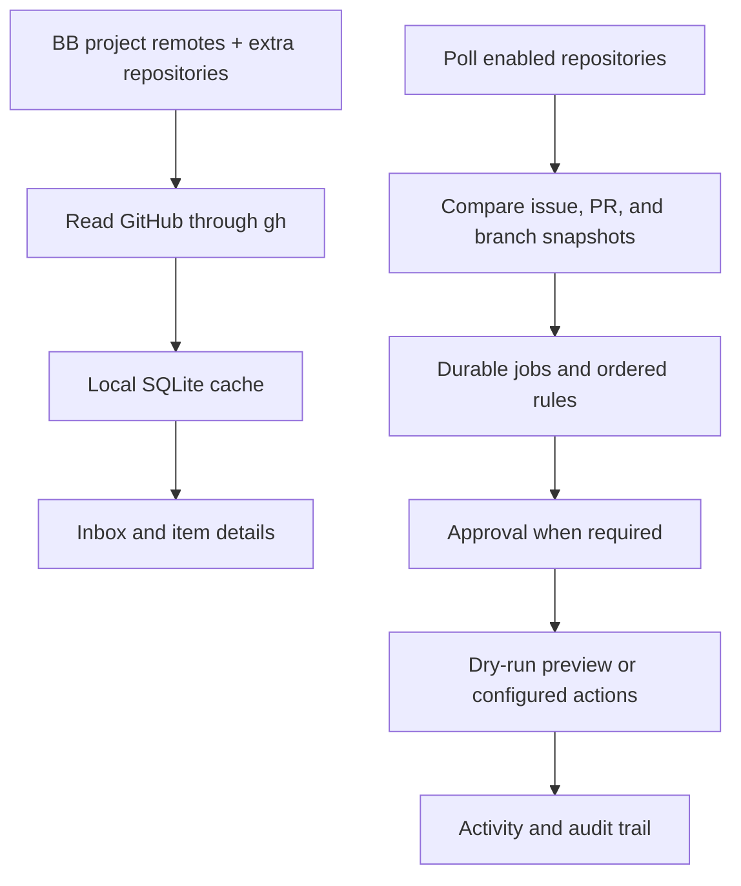

<div align="center">


# GitHub Extended

### Keep GitHub work moving, from one BB inbox.

Review issues, pull requests, and security alerts without leaving BB.<br>
Turn repeat work into automations you can inspect and approve.


[Features](#features) · [Install](#install) · [How it works](#how-it-works) · [CLI](#cli) · [Settings](#settings) · [Development](#development)

<br>



</div>

<br>

> [!NOTE]
> The screenshots are real BB captures populated with fictional demo data.

## The problem

You need to review GitHub work, follow up on it, and keep the conversation with
your agent attached to the right issue or pull request. Separate lists and
manual follow-up make it easy to lose context.

| Work | Without GitHub Extended | With GitHub Extended |
| --- | --- | --- |
| Review the queue | Check issues, PRs, and security alerts separately | One Inbox with shared repository scope |
| Repeat a workflow | Run each follow-up step yourself | Rules for issue, PR, review, CI, and base-branch events |
| Keep context | Match conversations to GitHub items by hand | Linked item conversations and an Activity history |

## Features

<table>
<tr>
<td width="50%" valign="top">

### 📥 One inbox

See issues, pull requests, high-priority security alerts, and pending approvals.
Start with **Needs attention**, or switch to **Everything** and filter by type.
Pull requests show their state icon, CI checks, review decision, branches, and change counts.

</td>
<td width="50%" valign="top">

### 🔎 Read the details

Inspect discussions, checks, reviews, and diffs. Create issues, comment, change
state, assign people, and edit labels using your GitHub permissions.

</td>
</tr>
<tr>
<td valign="top">

### ⚙️ Automate repeat work

Match events to ordered rules. Review queued work before it runs, inspect
outputs, and retry failed jobs from Activity.
Choose a provider, model, and thinking level per rule, or inherit project defaults.

</td>
<td valign="top">

### 🧩 Describe a custom action

Choose **Ask agent (something else…)** and write the action you need.
Custom tasks use the same approval and dry-run controls as built-in actions.

</td>
</tr>
<tr>
<td valign="top">

### 💬 Keep the conversation attached

**Ask agent** opens BB's native composer. Choose your task, project, model,
environment, and permissions, then return to the linked conversation later.

</td>
<td valign="top">

### 📄 Reach older work

Page through lists with 25, 50, or 100 rows. Activity queries the full stored
history for the selected repository, including older runs and their audit details.

</td>
</tr>
</table>

<div align="center">
<table>
<tr>
<td align="center"><br><sub><b>Review the trigger, action, and approval</b></sub></td>
<td align="center"><br><sub><b>Follow each run in Activity</b></sub></td>
</tr>
</table>
</div>

## Install

```sh
bb plugin install git:https://github.com/MacHatter1/bb-plugin-github-extended --yes
```

Open **GitHub+** in BB. Repositories are discovered from your projects' GitHub
`origin` remotes; add others in Settings.

<details>
<summary><b>Install from a local clone</b></summary>

```sh
git clone https://github.com/MacHatter1/bb-plugin-github-extended
cd bb-plugin-github-extended
npm install
npm run build
bb plugin install path:$PWD --yes
```

</details>

**Requirements**

- BB with Plugin SDK **0.6.49 or newer**.
- The [GitHub CLI](https://cli.github.com/), authenticated for `github.com`:
  `gh auth login`, then `gh auth status --hostname github.com`.
- Access to the repositories you track. Dependabot alerts must be enabled and
  may need additional permissions; see [troubleshooting](docs/TROUBLESHOOTING.md).

GitHub Enterprise remotes are not discovered. The plugin uses `github.com`.

## Where to find it

| Where | What |
| --- | --- |
| **GitHub+ → Inbox** | Issues, pull requests, security alerts, and approvals, with search and type filters |
| **GitHub+ → Automations** | Saved rules, immediate on/off switches, native creation composer, and the manual builder |
| **GitHub+ → Activity** | Run outputs, audit details, replay controls, and linked agent conversations |
| **GitHub+ → Settings** | Tracked repositories and advanced automation enablement, polling, and quota controls |
| **Ask agent** on an item | Investigate, fix, or review it in BB's native composer |
| **@** and **#** in the composer | Mention tracked GitHub issues and pull requests |

## How it works



- **Browse from the cache.** A read-only sync refreshes GitHub data every five
  minutes. Repository health explains partial access and failed refreshes.
- **Start with a baseline.** The first automation poll records existing state
  rather than replaying old issues or PRs. Only enabled repositories are polled.
- **Build the rule you need.** Choose Repository → When → Conditions → Action →
  Approval. Multiple triggers, actions, condition groups, templates, and JSON
  live under Advanced.
- **Keep drafts intact.** Concurrent rule changes block stale saves. Rule switches
  persist immediately, and edits made during a save remain in your draft.
- **Inspect the result.** Jobs retain their action output and audit trail.
  Completed actions are not repeated when you replay a job.

See the [automation guide](docs/AUTOMATION.md) for setup, all events and actions,
template variables, polling limits, retries, and quota behaviour.

## Safe by default

- 🧪 **Dry run starts on.** Matched jobs record intended actions without starting
  agents, posting to GitHub, or updating checkouts. Review them before going live.
- 🧾 **Review new rules.** Rules created from chat start disabled and require
  approval unless you explicitly request different settings.
- 🔐 **Use your existing GitHub access.** Reads and writes use the installed `gh`
  executable. The plugin does not store a separate GitHub token. Cached items,
  health, links, rules, jobs, and audit records stay in local SQLite storage.
- 🧰 **Choose the scope of agent work.** Item tasks open a configurable composer.
  Automatic custom actions run in managed worktrees with `accept-edits` permissions;
  GitHub text is supplied as untrusted context. Review changes before accepting them.
- 📁 **Understand writes.** Comments, reviews, labels, and custom tasks can change
  external state when enabled. Checkout updates use a fast-forward-only pull on
  the configured base branch in the attached project checkout.

<details>
<summary><b>Running alongside BB's built-in GitHub plugin</b></summary>

The commands, storage, and panel routes are separate: `bb github-extended` and
`bb github` do not overwrite each other. Running both can duplicate panels,
mention suggestions, background refreshes, and API traffic. Keep the built-in
`github` plugin disabled if you want a single GitHub surface.

</details>

## CLI

```sh
bb github-extended repos
bb github-extended issues acme/api
bb github-extended prs acme/web
bb github-extended jobs
```

List commands read cached data and return plain text. Use `sync` to refresh it.
The explicit command form is `bb plugin run github-extended <command>`.

<details>
<summary><b>All commands</b></summary>

| Command | Does |
| --- | --- |
| `repos` | List repositories discovered from BB projects and `extraRepos` |
| `issues [owner/repo]` | List cached open issues |
| `prs [owner/repo]` | List cached open pull requests |
| `sync` | Refresh the cache from GitHub |
| `rules` | List automation rules and their enabled/approval state |
| `jobs` | List the latest 50 automation jobs |
| `poll` | Poll enabled repositories and queue newly detected events |
| `approve <job>` | Approve and queue a job waiting for approval or replay |
| `help` or `--help` | Show command usage |

Polling can queue work for the automation worker. Approving a job allows its
configured actions to run, subject to dry run and the saved rule settings.

</details>

**Agent tool:** `github_extended_create_rule` saves a rule for the current
project's repository, or an explicit `repo`. The bundled
[automation skill](skills/github-automation/SKILL.md) explains events, actions,
and safe defaults; the [CLI skill](skills/github-extended/SKILL.md) covers
browsing and inspecting stored work.

## Settings

Use `bb plugin config github-extended`, or open the plugin's settings in BB.
The GitHub+ Settings drawer contains repository and automation controls.

<details>
<summary><b>All plugin settings</b></summary>

| Setting | Default | Effect |
| --- | --- | --- |
| `extraRepos` | Empty string | Comma-separated `owner/repo` entries, in addition to project remotes; invalid entries are ignored and logged |
| `defaultProject` | Unset | BB project for repositories that are not attached to a discovered project |
| `automationDryRun` | `true` | Record intended automation actions without starting agents, posting, or updating checkouts |

```sh
bb plugin config github-extended set extraRepos "acme/api,acme/web"
```

Advanced automation settings also control polling: enabled by default, every
300 seconds, adjustable from 60 to 3,600 seconds. The GraphQL quota pause floor
starts at 100 remaining points and accepts 0–5,000. Automation is off for each
repository until you enable it. See the [automation guide](docs/AUTOMATION.md).

</details>

<details>
<summary><b>Turning it off</b></summary>

```sh
bb plugin disable github-extended
bb plugin enable github-extended
```

To stop scheduled event detection, turn off polling or disable the repository under
**Settings → Advanced automation settings**.

</details>

## Development

```sh
npm install
npm test
npm run typecheck
npm run build
npm run check:package
bb plugin install path:$PWD --yes
bb plugin dev
```

```text
src/server.ts          GitHub access, cache, RPC, CLI, and tool registration
src/app.tsx            GitHub+ panel and item details
src/automation/        Rules, polling, quota, jobs, and orchestration
src/*-view.tsx         Inbox, automation, and Activity surfaces
skills/                Bundled agent guidance
scripts/               Build, package checks, and logo generation
docs/                  Guides, logo, and fictional-data screenshots
```

Tests cover parsing, filtering, polling, rule validation, action lifecycles,
concurrent edits, pagination, and access failures. Render tests exercise the
panel through the SDK test runtime; fake-host integration tests use SQLite.
`check:package` checks generated bundles and a clean packed-consumer install.

`dist/` is generated and stays out of Git. Rebuild before packaging or reloading
a development checkout. [Troubleshooting](docs/TROUBLESHOOTING.md) covers access,
missing repositories, and plugin logs. `PLUGIN_OVERVIEW.md` is the store listing;
keep it in step with this README and the descriptions in `package.json`.

To regenerate the logo, run `node scripts/make-logo.mjs --hugeicons <directory>`
with a directory containing `node_modules/@hugeicons/core-free-icons`. It uses
the manifest's GitHub glyph and the repository's blue gradient.

## Licence

[MIT](LICENSE)
